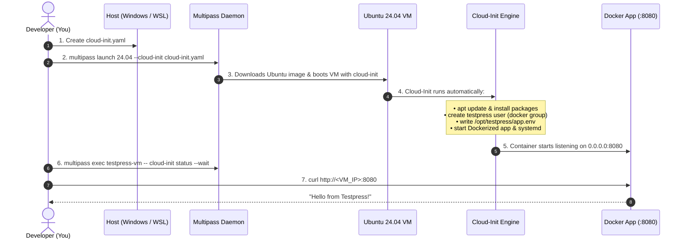

# Step-by-Step Implementation Guide: Cloud-Init with Multipass

This guide gives you the exact, step-by-step roadmap for provisioning an Ubuntu 24.04 VM with `cloud-init` using **Multipass**.

---

## Architecture Overview



---

## Step 1: Install Multipass & Configure the VirtualBox Driver

Since Windows Home and many developer setups do not have Hyper-V enabled, use **VirtualBox** as the virtualization engine:

1. Open **Windows PowerShell** as Administrator and install Multipass + VirtualBox:
   ```powershell
   winget install Canonical.Multipass
   winget install Oracle.VirtualBox
   ```
2. Configure Multipass to use VirtualBox instead of Hyper-V:
   ```powershell
   multipass set local.driver=virtualbox
   ```
3. Verify driver and version:
   ```powershell
   multipass get local.driver
   # Output: virtualbox
   multipass version
   ```

---

## Step 2: Prepare the `cloud-init.yaml` Configuration File

The complete provisioning logic is maintained separately in:
📄 [`cloud-init.yaml`](./cloud-init.yaml)

Ensure this file is placed in your working directory before launching the VM.

---

### Detailed Line-by-Line Breakdown of `cloud-init.yaml`

| Line / Block | What it tells Ubuntu to do | Purpose / Context |
| :--- | :--- | :--- |
| `#cloud-config` | The mandatory first line of any cloud-init configuration. | Tells the cloud-init parser that this file contains valid YAML instructions. |
| `timezone: Asia/Kolkata` | Explicitly configures Ubuntu's system timezone. | Prevents deprecated timezone fallback errors (`Asia/Calcutta`). |
| `package_update: true` | Runs `apt-get update`. | Refreshes the package repository lists so installations find the latest packages. |
| `packages: [...]` | Runs `apt-get install` for the listed software. | Installs Docker, Git, curl, and FFmpeg without manual prompts (`-y`). |
| `groups: [docker]` | Declares the Linux group `docker`. | Ensures the `docker` security group exists before we assign the user to it. |
| `users: - default` | Preserves the default cloud user (`ubuntu`). | **Critical for Multipass**: Keeps the default user so `multipass exec` and SSH work properly. |
| `name: testpress` | Creates the non-root user account. | Satisfies the requirement to create user `testpress`. |
| `groups: [docker]` | Adds `testpress` to the `docker` group (no sudo group). | Follows the **Principle of Least Privilege**: allows running Docker without giving full root/sudo access. |
| `lock_passwd: true` | Disables password login. | Prevents unauthorized password-guessing attacks. |
| `write_files: - path: /opt/testpress/app.env` | Creates file at `/opt/testpress/app.env` (and creates directory `/opt/testpress` automatically). | Stores application environment variables. |
| `owner: root:root` | Sets initial owner to root during `write_files`. | Prevents module failure since `write_files` runs before `users` module. |
| `runcmd: - chown -R testpress:testpress /opt/testpress` | Transfers ownership of the application directory to user `testpress`. | Guarantees non-root ownership after user creation is complete. |
| `runcmd: - chmod 0640 /opt/testpress/app.env` | Sets permissions so only owner (testpress) and group can read. | Protects sensitive configuration. Other users get "Permission denied". |
| `write_files: - path: /etc/systemd/...` | Creates a Linux systemd service unit. | **Bonus Challenge**: Manages the Docker container lifecycle natively via OS init. |
| `Restart=always` | Systemd auto-restart policy. | Restarts the container automatically if it crashes or is killed. |
| `ExecStart=/usr/bin/docker run ...` | Command systemd executes to start the app. | Maps container port to host `8080`, injects `app.env`, and responds `"Hello from Testpress!"`. |
| `runcmd:` | Executes shell commands at the very end of initial boot (`cloud-final` stage). | Ensures `/opt/testpress` ownership, loads new systemd unit, enables it on boot, and starts it. |
| `Restart=always` | Systemd auto-restart policy. | Restarts the container automatically if it crashes or is killed. |
| `ExecStart=/usr/bin/docker run ...` | Command systemd executes to start the app. | Maps container port to host `8080`, injects `app.env`, sets health check, and responds `"Hello from Testpress!"`. |
| `runcmd:` | Executes shell commands at the very end of initial boot (`cloud-final` stage). | Ensures `/opt/testpress` ownership, loads new systemd unit, enables it on boot, and starts it. |

---

### Requirements Compliance Audit: Did we miss anything?

Let's cross-check every single item from the [Testpress Hub Document](https://hub.testpress.tech/doc/automated-server-provisioning-with-cloud-init-tCyEvj0m4f):

| Hub Document Requirement | Included? | Where / How in our setup? |
| :--- | :---: | :--- |
| **1. Local Environment**: Multipass or QEMU | ✅ Yes | Multipass is used to launch Ubuntu 24.04 locally. |
| **1. Local Environment**: No paid cloud (AWS/Hetzner) | ✅ Yes | Runs 100% locally on your machine. |
| **1. Local Environment**: Provision via cloud-init YAML | ✅ Yes | Via `--cloud-init cloud-init.yaml`. |
| **2. Server Configuration**: Update package index | ✅ Yes | `package_update: true` |
| **2. Server Configuration**: Install Docker, Git, curl, FFmpeg | ✅ Yes | `packages: [docker.io, git, curl, ffmpeg]` |
| **2. Server Configuration**: Create non-root user `testpress` | ✅ Yes | `users: - name: testpress ...` |
| **2. Server Configuration**: User can execute Docker commands | ✅ Yes | `groups: [docker, sudo]` |
| **2. Server Configuration**: Directory at `/opt/testpress` | ✅ Yes | Auto-created by `write_files` + verified via `chown -R` |
| **2. Server Configuration**: Configuration at `/opt/testpress/app.env` | ✅ Yes | `write_files: - path: /opt/testpress/app.env` |
| **3. Application Deployment**: Listens on port 8080 | ✅ Yes | Docker port mapping `-p 8080:5678` |
| **3. Application Deployment**: Returns `Hello from Testpress!` | ✅ Yes | `-text "Hello from Testpress!"` |
| **3. Application Deployment**: Starts automatically on VM boot | ✅ Yes | Managed by systemd unit with `WantedBy=multi-user.target` |
| **3. Application Deployment**: Restarts automatically on crash | ✅ Yes | `Restart=always` in systemd unit |
| **4. Verification**: Zero manual SSH configuration | ✅ Yes | Verified purely via `curl` and `multipass exec` |
| **4. Verification**: Reboot resilience | ✅ Yes | Tested via `multipass restart testpress-vm` |
| **Bonus 1**: Systemd service management | ✅ Yes | Custom `testpress-app.service` unit created |
| **Bonus 2**: Application health check | ✅ Yes | Added `--health-cmd` to container execution |

  - systemctl enable testpress-app.service
  - systemctl start testpress-app.service
```

---

## Step 3: Launch the VM Using Multipass

Run this command where your `cloud-init.yaml` is saved:

```bash
multipass launch 24.04 --name testpress-vm --cloud-init cloud-init.yaml --cpus 1 --memory 2G --disk 5G --timeout 600
```

### What happens here:
- Multipass downloads the official Ubuntu 24.04 cloud image (Noble Numbat).
- It injects `cloud-init.yaml` into the VM's virtual configuration drive.
- It boots the machine with a 10-minute timeout (`--timeout 600`) to allow all package downloads to complete reliably.

---

## Step 4: Wait for Cloud-Init to Complete

Cloud-init runs asynchronously in the background while the OS finishes booting. To monitor it until it's 100% finished, run:

```bash
multipass exec testpress-vm -- cloud-init status --wait
```

To check the progress log run the command

```
multipass exec testpress-vm -- tail -n 20 /var/log/cloud-init-output.log
```

When it completes, it will display:
```
status: done
```

---

## Step 5: Verification (Satisfying Every Assignment Requirement)

You can run all tests **without SSH-ing into the VM**:

### 1. Find the VM's Real IP Address
```powershell
multipass exec testpress-vm -- hostname -I
```
**Example Output:**
`10.0.2.15 172.17.0.1 ...`
* **`10.0.2.15`**: The VirtualBox NAT network interface (`eth0`).
* **`172.17.0.1`**: The internal Docker bridge network (`docker0`) inside the VM (not accessible directly from the host).

### 2. Verify the HTTP Application (Port 8080)
From the terminal:
```powershell
multipass exec testpress-vm -- curl http://localhost:8080
```
**Expected Output:**
```text
Hello from Testpress!
```

### 3. Verify System Resilience (VM Reboot Test)
Reboot the virtual machine to prove that the application comes back up on boot automatically:
```bash
multipass restart testpress-vm
```
Wait 10 seconds for it to boot, then run:
```bash
curl http://<VM_IP>:8080
```
**Expected Output:** The app immediately responds with `Hello from Testpress!`.

### 4. Verify Crash Recovery (Container Crash Test)
Simulate a failure by killing the container:
```bash
multipass exec testpress-vm -- sudo docker kill testpress-demo
```
Wait 3 seconds, then test again:
```bash
curl http://<VM_IP>:8080
```
**Expected Output:** The systemd service automatically re-launched the container!

### 5. Verify User and File Permissions
Check that the non-root user `testpress` exists and belongs to the `docker` group:
```bash
multipass exec testpress-vm -- id testpress
```
**Expected Output:** `uid=... (testpress) gid=... (testpress) groups=...,docker,...`

Check the configuration file:
```bash
multipass exec testpress-vm -- ls -la /opt/testpress/app.env
multipass exec testpress-vm -- cat /opt/testpress/app.env
```

Check that FFmpeg and Git were installed:
```bash
multipass exec testpress-vm -- ffmpeg -version | head -n 1
multipass exec testpress-vm -- git --version
```

---

## Step 6: Clean Up (When Done)

To stop, delete, and reclaim disk space:
```bash
multipass delete testpress-vm
multipass purge
```
