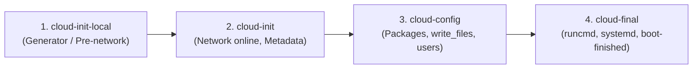

# Automated Server Provisioning with Cloud-Init

This repository contains the complete, automated server provisioning setup for an **Ubuntu 24.04** virtual machine using **cloud-init** and **Multipass**, developed for the Testpress DevOps learning exercise.

---

## 📋 Overview & Requirements Satisfied

The entire server setup is 100% automated via `cloud-init.yaml` with **zero manual SSH configuration**:

1. **Local Environment**:
   - Provisions an official Ubuntu 24.04 instance locally via Multipass without using any paid cloud infrastructure.
2. **Server Configuration**:
   - Updates the package index (`package_update: true`).
   - Installs `docker.io`, `git`, `curl`, and `ffmpeg`.
   - Creates a dedicated non-root user `testpress` in the `docker` group (enforcing the Principle of Least Privilege without sudo rights).
   - Creates directory `/opt/testpress` owned by `testpress:testpress`.
   - Writes `/opt/testpress/app.env` with restricted permissions (`0640`).
3. **Application Deployment**:
   - Deploys a containerized HTTP service listening on port `8080`.
   - Returns `Hello from Testpress!` upon HTTP request.
   - Starts automatically on VM boot and restarts if crashed, managed natively via a systemd unit (`testpress-app.service`).
4. **Resilience & Idempotency**:
   - Persists across reboots.
   - Running cloud-init modules again does not duplicate users, files, or ports.

## 🚀 How to Reproduce the Setup

### Prerequisites
- Install **Multipass** and **VirtualBox** on your machine:
  ```powershell
  winget install Canonical.Multipass
  winget install Oracle.VirtualBox
  ```
- Configure Multipass to use VirtualBox:
  ```powershell
  multipass set local.driver=virtualbox
  ```

### Step 1: Launch the VM
Navigate to the directory containing `cloud-init.yaml` and run:

```powershell
multipass launch 24.04 --name testpress-vm --cloud-init cloud-init.yaml --cpus 1 --memory 2G --disk 5G --timeout 600
```

### Step 2: Wait for Provisioning Completion
```powershell
multipass exec testpress-vm -- cloud-init status --wait
```
When complete, it outputs:
```text
status: done
```

### Step 3: Verify the Running Application
```powershell
# Get all VM IP addresses:
multipass exec testpress-vm -- hostname -I

# Query the application via multipass exec:
multipass exec testpress-vm -- curl http://localhost:8080
# Output: Hello from Testpress!

# (Optional) Forward port 8080 to Windows so you can access it in your browser:
& "C:\Program Files\Oracle\VirtualBox\VBoxManage.exe" controlvm "testpress-vm" natpf1 "web,tcp,,8080,,8080"
# Now open your Windows browser: http://localhost:8080
```

---

## ⚙️ Cloud-Init Configuration

The full declarative provisioning configuration is maintained separately in:
📄 [`cloud-init.yaml`](./cloud-init.yaml)

For a detailed explanation of each configuration directive, refer to the [Detailed Line-by-Line Breakdown](./MULTIPASS_STEP_BY_STEP_GUIDE.md#detailed-line-by-line-breakdown-of-cloud-inityaml).

---

## 🔄 Cloud-Init Execution Stages & Frequency

Cloud-init executes in 4 distinct systemd phases during boot:



### 1. `cloud-init-local.service`
- **When**: Runs before the network is brought up.
- **Role**: Locates local data sources (e.g. `seed=/dev/sr0` in Multipass) and establishes kernel hostname.

### 2. `cloud-init.service` (Network stage)
- **When**: Network is online.
- **Role**: Fetches remote user-data/metadata (on public clouds), sets timezone, configures storage mount points, and processes user definitions (`users`).

### 3. `cloud-config.service` (Config stage)
- **When**: After users are defined.
- **Role**: Executes configuration modules: `write_files`, `package_update`, and package installations (`docker.io, ffmpeg, git, curl`).

### 4. `cloud-final.service` (Final stage)
- **When**: At the end of the boot process before multi-user login.
- **Role**: Executes `runcmd` scripts (fixing file permissions, reloading and starting systemd units) and creates `/var/lib/cloud/instance/boot-finished`.

---

### Which Stages / Modules Run Once vs. Every Boot?

| Frequency | Description | Examples from Our Setup | Where State is Stored |
| :--- | :--- | :--- | :--- |
| **Once Per Instance** (`once-per-instance`) | Runs only the very first time the VM is initialized. Skipped on all subsequent reboots. | • User creation (`testpress`)<br/>• Package install (`docker.io, ffmpeg`)<br/>• `write_files`<br/>• `runcmd` | `/var/lib/cloud/instances/<id>/sem/` |
| **Every Boot** (`always` / `per-boot`) | Runs every time the operating system boots up. | • Network route setup<br/>• Metadata re-evaluation<br/>• Starting enabled systemd units (`testpress-app.service`) | Systemd target hooks |

For the exact execution logs, see [VERIFICATION_COMMANDS_AND_OUTPUTS.md](./VERIFICATION_COMMANDS_AND_OUTPUTS.md).
